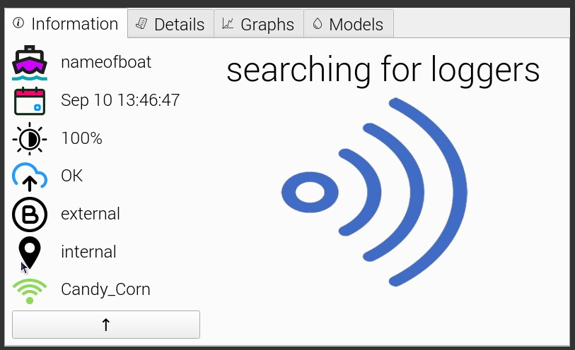

# Deck Data Hub

Application to download Bluetooth-enabled data loggers in fishing and research vessels.

link test

[james](https://htmlpreview.github.io/?https://github.com/kazola/md_test/blob/b78bea3c9ab596a88cc43b542c352a242e4f13eb/10056DeckDataHubAssemblyProcedurev10.html)

## License

This project is licensed under GPL License - see COPYING file for details
